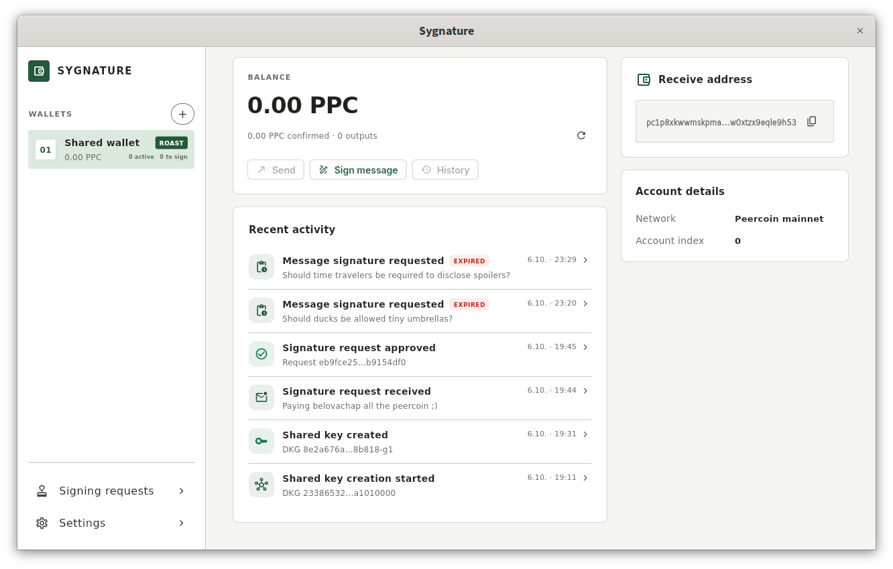
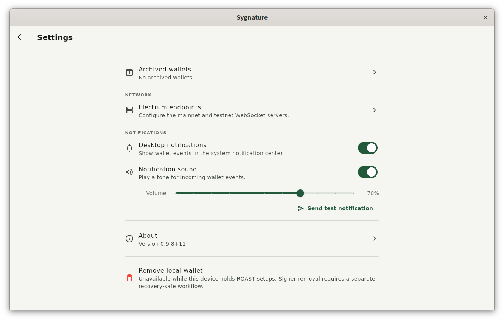

# Sygnature

Sygnature is a self-custody Peercoin wallet for individuals and groups. Think of
it as a shared digital safe: several people can manage the same funds, with an
agreed number of approvals required to make a payment. Each participant holds
a private signing share on their own device; the complete private key is never
assembled. Ordinary personal wallets are supported too.

A team treasury, community fund or family savings pool can use Sygnature to
share responsibility without giving one person sole control of the money.

> **Alpha software — use at your own risk.** Breaking changes, including changes
> to storage formats and protocols, are possible at any time. Backward
> compatibility and data preservation are not guaranteed. The software is
> provided without warranty of any kind. Do not use it for funds you cannot
> afford to lose, and keep secure backups of your recovery material.

## What can be done with it?

### Manage funds together

Create a shared wallet and choose how many participants must approve spending.
For example, a club could use a two-of-three arrangement: any two members can
approve a payment, so one member cannot spend alone and one unavailable signer
need not prevent the group from acting.

Receive Peercoin at the shared wallet address, propose payments and review
transaction details before approving them. Once enough participants approve,
Sygnature combines their signing contributions and sends the transaction to
the network. Recent Activity helps participants follow wallet setup, signing
requests and payment broadcasts.

### Approve statements as a group

Shared wallets can also sign exact text. A committee could jointly approve a
funding announcement, publish its official payment address or acknowledge a
project milestone.

Participants review the text before signing. The requester receives a portable
signed-message JSON document that can be verified independently. The signature
proves approval by the signing group; it does not establish the participants'
real-world identities or the statement's legal validity.

### Keep personal and shared wallets in one app

Create personal wallets from a recovery phrase and manage multiple locally
named wallets. Sygnature synchronizes balances and available funds, constructs
payments and broadcasts signed transactions through ElectrumX servers.

Both Peercoin mainnet and testnet are supported. Testnet provides a way to try
wallet creation and shared approvals without using real funds.

## How a shared wallet works

1. **Choose the group.** Decide who can sign and how many approvals are needed.
   Participants share their public identity keys with the creator, who issues
   a separate invitation for each signer.
2. **Join and create the wallet.** Each participant opens their invitation and
   connects. The group jointly generates the wallet, with each device keeping
   its own private signing share.
3. **Receive funds.** Use the shared address to receive Peercoin like any other
   wallet.
4. **Review and approve.** Propose a payment, check its destination, amount and
   fee, and collect the required approvals. Sygnature signs and broadcasts the
   transaction when the threshold is met.

[](https://github.com/user-attachments/assets/59e0db62-0948-4aa1-af76-84cdd23c5003)

## Shared control, private signing policy

Sygnature uses **threshold signatures**, rather than an on-chain multisig
script. Shared payments look like ordinary single-signature Taproot
transactions: the signature does not reveal the number of participants or the
approval threshold. This keeps the signing arrangement private, but does not
hide payment amounts or transaction history.

Under the hood, ROAST coordinates FROST signing rounds so that enough responsive
signers can complete a signature even when other signers are unavailable. The
app uses Noosphere for coordination and encrypted [Iroh](https://www.iroh.computer/)
connections between participants and the group's coordinator, without a central
Sygnature service. The coordinator must be available for the group to work,
but cannot authorize a payment on its own.

Secret wallet material and shared-wallet state are stored in encrypted local
vaults backed by platform secure storage. Signing requests are validated against
the expected wallet, and transaction details are bound to the signatures being
requested.

For protocol, connectivity and security details, see
[ARCHITECTURE.md](ARCHITECTURE.md).

## Screenshots




## Development

Sygnature is built with Flutter and targets Android, iOS, Linux, Windows and macOS.
See [scripts/README.md](scripts/README.md) for platform dependencies, build
instructions and packaging.

```sh
flutter analyze
flutter test
flutter run -d linux
```

See [Secure-storage device tests](docs/secure-storage-device-tests.md) for the
isolated Android and Apple device test instructions.

## License

Copyright 2026 peerchemist.

Licensed under the [BSD 3-Clause License](LICENSE). Third-party components
remain under their respective licences; see
[THIRD_PARTY_NOTICES.md](THIRD_PARTY_NOTICES.md) and **About → Licenses** in the
application.
